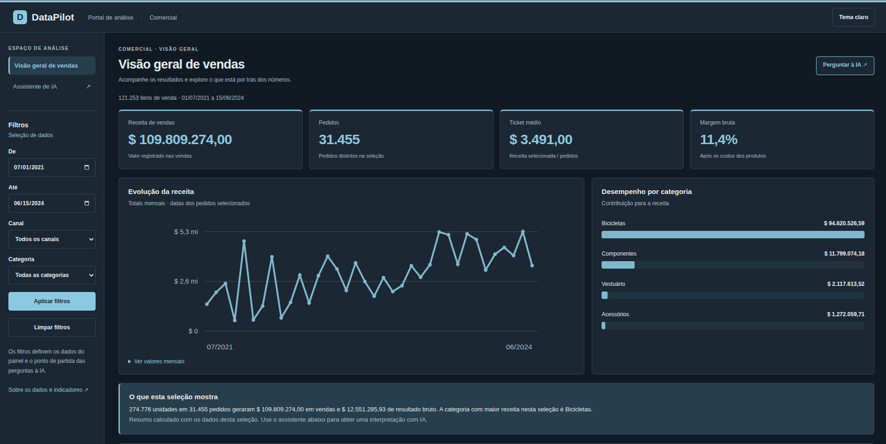
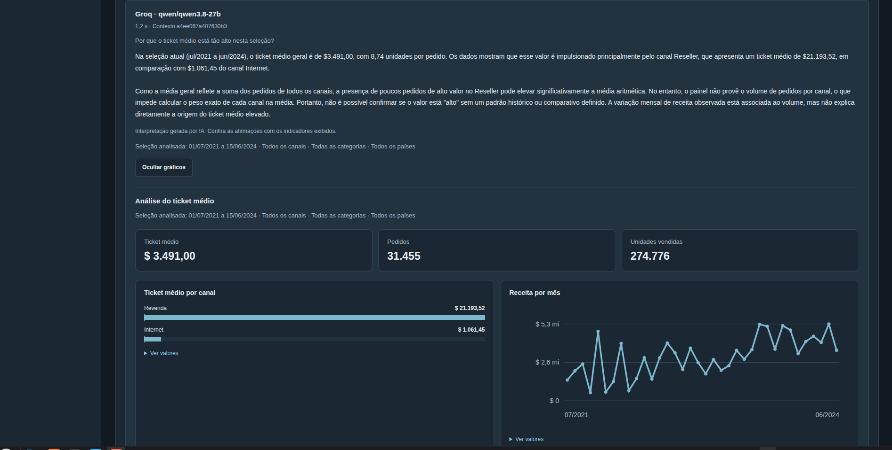

# DataPilot

[Português](readme.MD) · **English**

### Sales analytics with data, context and AI.

A dashboard for exploring sales metrics and an assistant for asking questions in natural language. The application calculates the numbers; AI structures the analysis and explains the results.

**[Try the live demo →](https://data-pilot-neon.vercel.app/)** · [Run locally](#run-locally) · [Documentation](#documentation)

A personal learning and portfolio project developed with AI assistance. The goal is to connect data analysis, web development and software engineering in a usable application, with documented technical decisions and limitations. The interface is in Brazilian Portuguese.

## Live demo

**Deployed on Vercel, with the complete access and analysis flow confirmed by the author on October 23, 2026.** The earlier email request issue was resolved by registering the origin again in Neon Auth without a trailing slash.

1. Open the site and explore the dashboard and its filters.
2. In the assistant section, request an access link by email.
3. Open the link in the same browser and ask a question about the data.
4. Read the answer and open the charts to explore the results.

The demo uses a static sample dataset. The dashboard is available without signing in; AI requires verified access and an available allowance. Defaults are **4 questions per account**, a shared cap of **20 questions per UTC day** and a **15-second** cooldown between questions. These values are configurable.

AI options depend on provider configuration and availability. Confirmation of the complete flow does not mean every model or question has been validated.

## Project preview

### Sales dashboard

An overview of sales metrics, filters and trends.



### Analysis assistant

A natural-language question, the assistant's answer and charts based on the selected data.



## What you can do

- Filter sales by date range, channel and category.
- Track revenue, distinct orders, average order value, units, cost and gross margin.
- Ask questions about sales, margin, order value and products in natural language.
- Explore metrics and charts selected from application-approved options.
- Continue a conversation with context from the last four exchanges and the previous analysis filters.
- View calculated metrics even if the AI explanation stage fails.
- Sign in through an email link and retain your account allowance after reloading.

**Nova conversa** (new conversation), filter changes or a page reload clear the in-memory history. Account allowance stays on the server; switching providers does not renew it. A failure after allowance reservation can consume a question.

## How it works

```text
6 CSVs → validated Python load → read-only SQLite
                                       ↓
                               FastAPI → web interface

Question → validated AI plan → SQL/Python metrics → AI explanation

Neon Auth → verified identity → Neon PostgreSQL → quota enforcement
```

AI proposes a plan within a validated contract. The application runs allowed queries and calculates the metrics; it does not execute arbitrary model-generated SQL. Filters, available options and aggregates are sent to the provider as needed for each analysis stage.

SQLite stores the analytics dataset and is rebuilt from CSVs during the Vercel build. Authentication and quotas use Neon; account allowance does not depend on local deployment files.

| Layer | Technologies |
| --- | --- |
| Data and metrics | Python, pandas, SQL and SQLite |
| API | FastAPI and Pydantic |
| Interface | HTML, CSS and JavaScript |
| Access and quotas | Neon Auth and PostgreSQL |
| AI | Configurable APIs, including Chat Completions-compatible endpoints |
| Hosting | Vercel |

## Run locally

Requirements: **Python 3.12–3.14**, Git and a terminal. Run commands from the repository root.

### Linux / macOS — Bash or Zsh

```bash
git clone https://github.com/Renanmrqs/DataPilot.git
cd DataPilot
python3 -m venv .venv
source .venv/bin/activate
python -m pip install -r requirements.txt
python -m src.etl.build_database
python -m uvicorn src.api.main:app --host 127.0.0.1 --port 8000
```

### Windows — PowerShell

```powershell
git clone https://github.com/Renanmrqs/DataPilot.git
cd DataPilot
py -m venv .venv
.\.venv\Scripts\python.exe -m pip install -r requirements.txt
.\.venv\Scripts\python.exe -m src.etl.build_database
.\.venv\Scripts\python.exe -m uvicorn src.api.main:app --host 127.0.0.1 --port 8000
```

Open **[http://127.0.0.1:8000](http://127.0.0.1:8000)**. Interactive API documentation is available at [http://127.0.0.1:8000/docs](http://127.0.0.1:8000/docs).

If you already cloned the project, start in the existing directory and create `.venv` only if needed. After a `git pull`, install `requirements.txt` again to include new dependencies. On Windows, stop the server before rebuilding the database.

### Configure AI

The dashboard works without AI credentials. To enable the assistant:

1. Copy [.env.example](.env.example) to `.env`.
2. Enter credentials and model identifiers for your chosen provider.
3. Restart the server.

Gemini, DeepSeek, OpenAI and other compatible endpoints are configurable. The **Groq** integration uses the internal `deepseek` identifier with `DEEPSEEK_BASE_URL` pointing to Groq; the interface identifies the provider from the endpoint.

The `.env` file is not versioned and does not come with `git pull`. Keep credentials private. Normal local mode does not require login or enforce demo quotas, but real calls consume provider allowance; this mode is intended for local use.

### Run with login and quotas

Configure Neon Auth, the PostgreSQL connection, quota tables and a provider following the [access guide](docs/demo-access.md). Then, with the virtual environment activated:

```bash
python -B -m scripts.run_demo
```

In PowerShell, use `.\.venv\Scripts\python.exe -B -m scripts.run_demo`. Setting `DEMO_AI_ENABLED=false` keeps chat paused.

## Deploy on Vercel

The [deployment guide — Portuguese](docs/deployment.pt-BR.md) covers the setup. FastAPI configuration is in `pyproject.toml`, with dependencies also recorded in `uv.lock`.

Local environment variables must be configured separately in Vercel. In Neon Auth, authorize the exact site origin, **without a trailing slash, path or fragment**:

```text
https://data-pilot-neon.vercel.app
```

Preview URLs are separate origins. Redeploy after changing environment variables in Vercel. Guides and checkpoints contain historical records; this README describes the current demo status.

## Metrics and limitations

| Metric | Definition |
| --- | --- |
| Orders | Distinct sales orders in the selection |
| Average order value | Selected revenue ÷ distinct selected orders |
| Gross profit | Revenue − product cost |
| Gross margin | Gross profit ÷ revenue, where defined |

Monetary values are stored in cents. The source uses `$`; the currency has not been confirmed. Gross profit excludes operating expenses and is not net profit.

The loader checks keys, relationships, dates, values and total reconciliation before replacing the database. The dataset is not an integration with actual companies. Partial months and missing benchmarks or causal data limit conclusions.

AI explanations can contain errors, even with application-calculated metrics. QVD ingestion, per-client configuration and client isolation are not implemented.

## Tests

With the virtual environment activated:

```bash
python -B -m unittest discover -s tests -v
```

In PowerShell, use `.\.venv\Scripts\python.exe -B -m unittest discover -s tests -v`.

The standard suite uses temporary databases and simulated providers without real AI calls. PostgreSQL tests are optional. UI checks and live calls have separate procedures in the [test guide — Portuguese](tests/README.md).

## Repository layout

| Location | Responsibility |
| --- | --- |
| `data/raw/` | Demo CSVs |
| `src/etl/` and `sql/schema.sql` | Validated loading and relational schema |
| `src/analytics/` | Deterministic metrics and queries |
| `src/ai/` | Providers and analysis-plan validation |
| `src/api/` | Routes, authentication and analysis orchestration |
| `src/demo/` | Configuration, identity and persistent quotas |
| `src/web/` | Interface and charts |
| `tests/` and `scripts/` | Tests and utilities |
| `docs/` | Technical guides, decisions and checkpoints |

## Next steps

- Improve error messages and observability for access and AI flows.
- Expand examples and checks for model responses.
- Extend analyses and comparisons between periods.
- Investigate reusing data prepared in Qlik Sense, with explicit metrics and relationships per dataset.

These are future directions, not available features. Reading QVDs does not automatically reproduce Qlik application measures or associations.

## Documentation

- [Prototype guide](docs/prototype.md)
- [Access, authentication and quotas](docs/demo-access.md)
- [Vercel deployment — Portuguese](docs/deployment.pt-BR.md)
- [Technical analysis flow](docs/business-analysis.md)
- [Development and learning — Portuguese](docs/desenvolvimento.pt-BR.md)
- [Tests and validation — Portuguese](tests/README.md)
